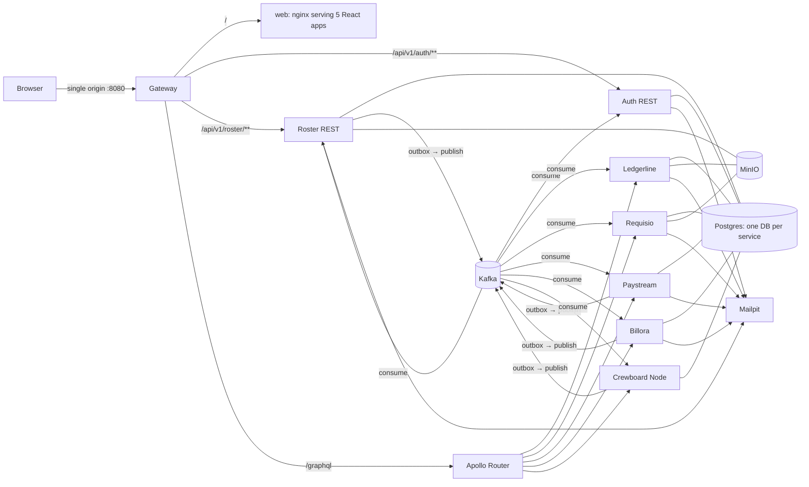

# MosaicHub — Platform Architecture

This file is the single source of truth for rules that apply to every service. A `SPEC.md` adds service-specific behaviour on top and never contradicts this file. If a conflict appears, stop and ask Emmanuel.

## 1. System overview

**Who publishes:**
- Roster publishes employees, organizations, offices, departments and compensation.
- Paystream publishes payslips.
- Billora publishes invoices.
- Crewboard publishes clients and projects.
- Auth, Ledgerline and Requisio publish nothing.

**Who consumes:** every service consumes what it needs. The full catalogue is in `docs/EVENTS.md`.

## 2. Stack
- **Java services:** Java 21, Spring Boot 4.1.x (newest stable patch), Maven.
  - Spring Security with the OAuth2 Resource Server, Spring Data JPA/Hibernate, Flyway, Spring Kafka.
  - Spring for GraphQL with Apollo `federation-jvm` for the subgraphs.
  - springdoc-openapi for the REST services.
  - OpenPDF for PDF generation.
  - AWS SDK v2 S3 client for MinIO.
- **Retries:** use Spring Framework 7's built-in `@Retryable` and `@ConcurrencyLimit` instead of the separate spring-retry library.
- **Crewboard:** Node 24 LTS, TypeScript (strict), Express 5, Apollo Server with its Express integration and `@apollo/subgraph`, Prisma + Prisma Migrate, Zod, `jose`, `@confluentinc/kafka-javascript`, Vitest.
- **Edge:** Spring Cloud Gateway (WebFlux flavour), on the release train that matches Boot 4.1. Apollo Router for Federation v2, with the supergraph composed by Rover into the committed file `infra/router/supergraph.graphql`.
- **Frontend:** React + TypeScript + Vite + Tailwind + shadcn/ui, React Router, TanStack Query, TanStack Table, React Hook Form + Zod, Recharts, Apollo Client for GraphQL, Vitest + React Testing Library, Playwright.
- **Infrastructure:** PostgreSQL 17, Apache Kafka (KRaft, single node), Kafka UI, MinIO, Mailpit, and the Grafana `otel-lgtm` image (optional profile).

## 3. Authentication (Mosaic Auth)
- **Single origin.** Everything is served through the Gateway at `http://localhost:8080`. Because of that, cookies work across all five React apps and no CORS setup is needed.
- **Users.** Auth consumes `roster.employees` and keeps a `credentials` row per employee: `userId`, `email`, `status`, `passwordHash`, `failedAttempts`, `lockedUntil`.
- **Account rules:**
  - An `INACTIVE` employee cannot log in.
  - On deactivation, Auth revokes all of that user's refresh tokens.
- **Invite flow.** When an employee is created, Auth emails a single-use set-password link that expires after 48 hours (it arrives in Mailpit). Roster can trigger a resend via `POST /api/v1/auth/invites/{userId}` (service token).
- **Passwords:**
  - BCrypt with strength 12.
  - At least 10 characters, with upper case, lower case, a digit and a symbol.
  - 5 failed attempts lock the account for 15 minutes.
  - "Forgot password" uses the same token mechanism as the invite.
- **Access token.** RS256, 15 minutes, held only in memory in the browser. Claims:
  - `sub` = userId (UUID)
  - `email`
  - `apps`, e.g. `["ROSTER","LEDGERLINE"]`
  - `typ: "user"`
  - `iat`, `exp`, `jti`
  - **No roles or permissions go in the token.**
- **Refresh token:**
  - Opaque value, 7-day lifetime, stored as a hash, rotated on every use.
  - If an already-used token is presented again, revoke that token's whole family.
  - Sent as an `httpOnly`, `SameSite=Strict` cookie scoped to path `/api/v1/auth`.
  - The refresh endpoint also requires the header `X-Requested-With: mosaichub`.
  - On page load, each app calls `POST /api/v1/auth/refresh` to get an access token. That's what makes single sign-on work across the apps.
- **Signing keys.** Stored in Auth's database in an `auth_signing_keys` table (`kid`, active flag, private key encrypted with `AUTH_KEY_ENCRYPTION_SECRET`). Public keys are exposed at `/api/v1/auth/.well-known/jwks.json`. The table supports rotation.
- **Service tokens:**
  - Issued by `POST /api/v1/auth/service-token` using the client-credentials grant, with client ID and secret from env.
  - Claims: `sub: "svc-<name>"`, `typ: "service"`, `scope` (e.g. `requisitions:read-approved`), lifetime 5 minutes.
  - Used whenever one service calls another. **A service never forwards a user's token to make its own calls.**
- **Every service validates tokens** with Spring's resource server (or `jose` in Node) against the JWKS endpoint. Gateway and Router pass the `Authorization` header through unchanged.

## 4. Access control (identical model in every app)

### 4.1 App access comes from Roster
An employee event carries `appAccess: [{ app, admin }]`, where `app` is one of `ROSTER`, `LEDGERLINE`, `REQUISIO`, `PAYSTREAM`, `BILLORA`, `CREWBOARD`. **Every employee has `ROSTER` implicitly**, because that's where their own profile lives.

### 4.2 Local employee table
Every service stores **all** employees from `roster.employees` in a local table with these columns:
- `user_id`, `employee_number`, names, `email`
- `org_id`, `office_id`, `department_code`, `manager_user_id`
- `status`
- `has_app_access`, `is_app_admin`

**Request guard (filter order):**
1. Token is valid.
2. The user exists locally with `status = ACTIVE`.
3. `has_app_access` is true.

If a check fails, return 403 with the problem type `no-app-access` or `inactive`.

The frontend shows a friendly **"You don't have access to this app yet — ask an admin"** page when the user has app access but no access level.

### 4.3 Access levels
- **Permissions** are named verb-first (`VIEW_VOUCHER`, `APPROVE_PAYROLL`) in a Java `enum` (a TS union in Crewboard) per service. A Flyway migration seeds a `permissions` table mirroring the enum, with a code, a description and a `scopeKind` of `ORG_OFFICE`, `ORG_OFFICE_DEPARTMENT`, `DEPARTMENT` or `NONE`. A startup check fails the app if the enum and the table drift apart.
- **Tables:**
  - `access_levels`: `id`, `name`, `description`, `system`, `org_access` (`ALL` | `SELECTED`), `office_access` (`ALL` | `SELECTED`), `department_access` (`ALL` | `SELECTED`, used only by Requisio and Paystream)
  - `access_level_permissions`
  - `access_level_organizations`
  - `access_level_offices`
  - `access_level_departments`
  - `user_access_levels` (`user_id`, `level_id`)
- **Seeded ADMIN level.** Flyway seeds one level per service called `ADMIN`: `system = true`, every permission, `ALL` scopes. It cannot be edited or deleted.
- **Event rules:**
  - `admin: true` for this app → the user is added to ADMIN.
  - The flag is removed → the user is removed from ADMIN.
  - App access removed → the user is removed from every level.
- **Other levels.** Admins create them with any set of permissions plus organization and office access (and department access where it applies). A user can hold **several** levels.
- **Effective access.** A user holds permission P if any of their levels grants it. For data filtering, the allowed organizations, offices and departments for P are the **union** across all the user's levels that grant P.
- **Implementation:**
  - Java: `platform-common` exposes `AccessContext` (`hasPermission(P)`, `scopeFor(P)`) and a Spring Data `Specification` helper that adds the org/office/department predicates.
  - Every list query and every single-record read goes through the scope filter.
  - Crewboard mirrors this in `src/access/`.

## 5. Kafka
The topic catalogue and the event envelope are in `docs/EVENTS.md`.

- **Topics:** named after the entity they carry (`<owner>.<entity-plural>`), with the change type in the envelope's `action` field. Topics are created by an init container with explicit partitions (3) and the cleanup policy listed in EVENTS.md.
- **Full state, always.** A message always contains the whole current record, never a diff. This is what makes compaction and replay correct.
- **Producers** use the **transactional outbox**: the business change and the outbox row are written in the same database transaction. A relay polls with `SELECT … FOR UPDATE SKIP LOCKED` every 500 ms, publishes keyed by the entity ID, and marks the row sent. The producer is idempotent (`enable.idempotence=true`, `acks=all`).
- **Consumers** are idempotent:
  - A `processed_events(event_id PK)` table is written in the same transaction as the side effect.
  - Retries: 3 attempts with exponential backoff, after which the message goes to `<topic>.dlt` with the error in its headers.
  - An admin-only Actuator endpoint replays messages from a DLT.
- **Replay.** Every compacted state topic can rebuild a service's tables. `make reset-data SERVICE=x` drops that service's database and resets its consumer group to the earliest offset.
- **Correlation.** Every message carries the HTTP request's `correlationId` in the envelope and in a header.

## 6. Data
- **Layout.** One Postgres instance. Each service has its own database and its own DB user, with no grants across services. Database names: `auth`, `roster`, `ledgerline`, `requisio`, `paystream`, `billora`, `crewboard`.
- **Migrations:** Flyway for the Java services (`V1__init.sql`, …) and Prisma Migrate for Crewboard. Hibernate `ddl-auto` is always set to `validate`.
- **IDs and timestamps:** UUID primary keys. Human-readable codes (`REQ-2026-00042`, `VCH-…`, `INV-…`, `PO-…`) are separate unique columns. Timestamps are `timestamptz` in UTC; the frontend displays `Africa/Accra` or the user's locale.
- **Money:** `numeric(19,4)` plus an ISO currency code. Never floating point. The base currency is GHS.
- **Encryption at rest:** bank account numbers (in Roster and Paystream) and salary amounts are encrypted with AES-GCM through a JPA `AttributeConverter`, using a key from env. They're shown masked except to permitted users.
- **Audit log.** Every state change writes an `audit_log` row in the same transaction: actor, action, entity, entity ID, before/after JSON with sensitive fields redacted, `correlationId`, and time. Each app has an audit view for users with `VIEW_AUDIT`.

## 7. Files (MinIO)
- **Buckets:** `roster-avatars`, `ledgerline-receipts`, `requisio-documents`. Each is private and stored on a Docker volume.
- **Upload flow:**
  1. The client asks the service for an upload URL, giving the file name, type and size.
  2. The service checks permission, the type (PDF, JPG or PNG) and the size (≤ 5 MB). It returns a presigned PUT URL valid for 5 minutes and creates a `file_attachments` row in status `PENDING`.
  3. The client uploads, then calls confirm.
  4. The service checks the object exists and verifies the content type by its leading bytes, then sets the row to `ACTIVE`.
- **Downloads:** presigned GET URLs valid for 5 minutes, issued only after the same scope checks as the record that owns the file.
- **Avatars** are served by Roster at `GET /api/v1/roster/employees/{userId}/avatar` (a redirect to a presigned URL), so other apps never copy them.
- **PDFs** (payslips, invoices, purchase orders) are generated on request and streamed to the user. They are **never stored**.
- **Endpoint:** the S3 client uses path-style access and an endpoint from env, so pointing it at real AWS S3 only takes a config change.

## 8. APIs

### 8.1 REST (Auth, Roster)
- Base path `/api/v1/<service>/…`, using Spring Boot 4's built-in API versioning.
- Errors as RFC 9457 Problem Details with `type`, `title`, `status`, `detail`, `instance`, `correlationId`, and `errors[]` for field validation.
- List endpoints: `?page=0&size=20&sort=field,asc` returning `{ content, page, size, totalElements, totalPages }`.
- Swagger UI at `/api/v1/<service>/docs`.

### 8.2 GraphQL (Ledgerline, Requisio, Paystream, Billora, Crewboard)
- Every subgraph is Federation v2, schema-first (`.graphqls` files). All are reached through the Router at `/graphql`, with Apollo Sandbox enabled locally.
- **Naming:** queries are nouns (`vouchers`, `voucher`); mutations are verb-first (`submitVoucher`).
- **Mutation payloads:** `{ <entity>, errors: [UserError!]! }`, where `UserError` is `{ code, message, field }`. Exceptions from authorization or "not found" become GraphQL errors with `extensions.code` (`FORBIDDEN`, `NOT_FOUND`, `NO_APP_ACCESS`).
- **Pagination:** offset style, `input PageInput { page, size }` returning `{ items, page, size, total }`, for consistency with REST.
- **Shared entities:**
  - `Viewer @key(fields: "userId")`: each subgraph contributes one field, e.g. `Viewer.ledgerline: LedgerlineViewer`. It's `null` when the user has no access to that app. The Portal fetches every app's widgets, tasks and notifications in one query.
  - `Requisition @key(fields: "reqId")` is owned by Requisio. Ledgerline contributes `remainingBalance` and `voucherCount`.
  - `Client @key(fields: "id")` and `Project @key(fields: "id")` are owned by Crewboard. Billora contributes `Project.invoicedTotal` and `Project.paidTotal`.
- **Entity resolvers** (`_entities`) only need a valid user token from an active employee, and they return only the fields that subgraph contributes. Root queries and mutations enforce the app's own permissions.
- **Protection:** depth limit 10 and a cost limit configured in the Router.

### 8.3 Summaries, tasks and notifications (feeding the Portal)
- Each app returns, for the current user:
  - `summary`: 2–4 named numbers that the Portal renders as widgets
  - `tasks`: items waiting on this user, each with `title`, `link` (a deep link into the app) and `createdAt`
  - `notifications`: with `markNotificationRead` and `markAllNotificationsRead`
- Roster serves these over REST (`/api/v1/roster/me/summary`, `/me/notifications`). The GraphQL apps serve them through `Viewer`.
- Notifications are stored per service in a `notifications` table, written in the same transaction as the event that triggers them.

## 9. Observability
- **Default:** structured JSON logs including `correlationId` and `userId`; Actuator `health`, `info` and `metrics`.
- **Optional `observability` profile:**
  - The Grafana `otel-lgtm` container (Grafana + Prometheus + Loki + Tempo + OTel collector).
  - Java services use `spring-boot-starter-opentelemetry`; Crewboard uses the OTel Node SDK.
  - Traces must cross HTTP → Router → subgraph → Kafka → consumer, with context passed in Kafka headers.
- **Two committed dashboards** in `infra/grafana/`:
  - "Platform overview": request rate, error rate and latency per service
  - "Kafka flow": consumer lag and DLT counts
- Teaching for this happens in M7.2 (see TEACHING.md).

## 10. Docker and dev workflow

**Compose profiles:**

| Profile | Runs |
|---|---|
| `infra` | Postgres, Kafka, Kafka UI, MinIO, Mailpit |
| `core` | infra + Auth, Roster, Gateway, Router, web |
| `finance` | core + Ledgerline, Requisio, Paystream |
| `billing` | core + Crewboard, Billora |
| `observability` | the Grafana LGTM stack |
| `all` | everything except observability |

**Ports:**

| Component | Port |
|---|---|
| Gateway (the only one a user needs) | 8080 |
| Auth / Roster / Ledgerline / Requisio / Paystream / Billora | 8081 / 8082 / 8083 / 8084 / 8085 / 8086 |
| Crewboard | 8087 |
| Router | 4000 |
| web (nginx) | 8088 |
| Postgres | 5432 |
| Kafka | 9092 |
| Kafka UI | 8090 |
| MinIO API / console | 9000 / 9001 |
| Mailpit UI / SMTP | 8025 / 1025 |
| Grafana | 3000 |
| Vite dev servers | 5173–5177 |

**Container rules:**
- Java images use multi-stage builds with layered jars and a non-root user.
- `JAVA_TOOL_OPTIONS=-XX:MaxRAMPercentage=75 -XX:+UseSerialGC`, memory limit 512 MB per Java service.
- Health checks on every container, and `depends_on: condition: service_healthy`.

**Dev workflow:**
- `make dev-<service>` stops that service's container and prints the command to run it locally (IntelliJ run config, `./mvnw spring-boot:run`, or `pnpm dev`) with `localhost` endpoints. The Gateway's routes use env overrides so it can point at a service running on the host.
- Vite dev servers proxy `/api` and `/graphql` to `localhost:8080`.

**Config:** everything comes from `.env`. Commit `.env.example`. Secrets in it are demo-only and clearly labelled.

## 11. Testing
- **Java:**
  - JUnit 5 + Mockito for unit tests.
  - Testcontainers (Postgres, Kafka, MinIO) for integration tests of repositories, consumers, the outbox relay and GraphQL/REST controllers (`HttpGraphQlTester`, `MockMvc`).
  - JaCoCo gate at ≥ 85% line coverage per service.
- **Contracts:** each producer test validates the messages it emits against `/contracts/<topic>.schema.json`; each consumer test feeds a sample message that matches the schema. The Router composition check (`rover supergraph compose`) runs in CI.
- **Node:** Vitest plus Testcontainers for Node, with coverage ≥ 85%.
- **Frontend:** Vitest + RTL on components with logic (forms, tables, permission-based rendering).
- **E2E:** Playwright against the `all` profile in CI. Headline flows:
  1. invite → set password → login
  2. voucher draft → step 1 → step 2 → paid
  3. requisition approved → voucher using its REQID
  4. payroll generate → approve → publish → payslip visible in Roster → reset → payslip gone
  5. invoice sent → payment → Crewboard revenue updates

## 12. Email
- Each service sends its own email through Spring Mail (or Nodemailer) to Mailpit, using Thymeleaf HTML templates in the MosaicHub style.
- Emails are triggered **after commit**, by a listener on the service's own outbox or domain event, so a rolled-back transaction never sends mail.

## 13. Frontend architecture
- **Workspace:**
  - `apps/portal` (base `/`)
  - `apps/roster-web` (`/roster`)
  - `apps/finance-web` (`/finance`)
  - `apps/billora-web` (`/billora`)
  - `apps/crewboard-web` (`/crewboard`)
  - `packages/ui` (Tailwind preset + shadcn/ui components + app shell)
  - `packages/auth` (`AuthProvider`, silent refresh, an `apps` hook)
  - `packages/api` (a fetch wrapper with Problem Details parsing; Apollo Client factory)
- **Build and serve:** one `web` nginx image serves all five builds. History-mode fallback is set per base path.
- **Shell:** every app shares the same shell — sidebar, top bar with app switcher, notifications bell, profile menu and theme toggle.
- **Permissions in the UI:** permission-aware rendering through a `can(permission)` helper fed by each app's `viewer` or `me` query. The UI only hides things; **the backend always enforces**.
- **Forms:** React Hook Form + Zod. Server field errors (`UserError.field`, Problem Details `errors[]`) are mapped back onto the form fields.
